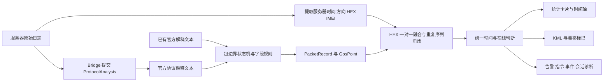

# TraceForge 产品需求文档（PRD）

| 项目 | 内容 |
| --- | --- |
| 文档版本 | V1.1 |
| 对应正式版本 | TraceForge V0.3.19.1 |
| 当前开发基线 | V0.3.19.1-optimal（主线检查点 `90a8eba`） |
| 更新日期 | 2026-10-10 |
| 作者 | Orion Q. |
| 文档状态 | 当前能力基线与后续规划 |

## 1. 产品概述

TraceForge 是面向 FAE、路测、客户联调与售后排查的 Windows 离线日志分析工具。它把服务器原始日志、官方协议解释、设备状态、异常提示和 KML 轨迹集中到一个界面，减少在文本、协议工具、表格和地图之间反复搬运数据造成的遗漏。

产品的核心价值不是替代设备平台或协议栈，而是把一次排查所需的信息组织成可阅读、可定位、可导出的诊断视图，让使用者能够快速回答以下问题：

- 设备在什么时间上报了什么数据？
- 哪些时段没有观察到有效终端上行？
- 定位、速度、方向、ACC、告警和指令是否存在时间关联？
- 轨迹是否存在异常跳点、零坐标或异常历史时间？
- 当前日志属于哪台设备、哪种型号，能否形成可分享的 KML？

## 2. 产品定位与边界

### 2.1 目标用户

- FAE 与售后工程师：批量排查现场日志、断联、告警和状态变化。
- 路测与联调人员：快速确认轨迹、设备行为和指令交互。
- 产品与研发协作人员：用统一时间轴复现现象并交换证据。
- 客户现场演示人员：以清晰界面展示设备运行情况和排查结论。

### 2.2 当前范围

- 支持 Concox / GT06；JT/T808 以试验性方式开放。
- 支持服务器原始日志和已有官方解析文本两类输入。
- 复用本机 ProtocolAnalysis 完成主要协议字段解码。
- 在本机完成结构化、原文融合、统计、时间轴和 KML 输出。
- 不依赖业务服务器，不上传客户日志，不要求平台 API。

### 2.3 当前不承担的职责

- 不作为设备实时监控平台或远程控制平台。
- 不替代 ProtocolAnalysis 的完整协议解码能力。
- 不承诺覆盖所有厂商私有扩展、所有 JT/T808 变体和分包形式。
- 不根据经纬度自动猜测设备时区。
- 不把“日志中未观察到上行”直接判定为设备物理断网。
- 暂不接入公司平台 API、OTA 服务和在线账号体系。

## 3. 典型使用场景

### 3.1 路测复盘

粘贴路测日志，查看定位点、速度、方向和 ACC 变化，框选异常时段后导出 KML，在 Google Earth 中复核路线和点位详情。

### 3.2 客户联调

把告警、指令／事件、登录／鉴权和有效上行放在同一时间轴，减少现场在多个工具间来回搜索，并为客户提供更直观的运行状态说明。

### 3.3 断联与重连排查

使用服务器收包时间判断有效终端上行。超过预设阈值后绘制断联提示，到下一条有效终端上行为止；结合登录包和后续定位判断是否发生重连。

### 3.4 GNSS 与安装问题排查

检查零坐标、历史时间回滚、轨迹漂移、定位状态和卫星数字段。卫星数当前已进入定位详情与 KML，独立趋势统计属于后续需求。

### 3.5 告警与指令排查

统计协议解析结果中的告警，并检测可能藏在 JT/T808 内容中的 ASCII 指令／事件；从卡片跳转到相关包位置，查看原始详情。

## 4. 解析原理概述

TraceForge 采用“官方解码 + 本地结构化 + 原文融合”的分层方式，而不是自己重写全部协议，也不是简单地按冒号切割文本。

解析分为六层：

1. **输入层**：保存完整原文；长日志编辑器只分页预览，不截断实际解析内容。
2. **官方解码层**：Bridge 通过 Windows UI 自动化操作本机 ProtocolAnalysis，选择协议、提交原文并取回解释文本。
3. **结构化层**：按包头和校验行建立包边界，用字段专用规则提取包类型、设备时间、坐标、速度、方向、ACC、卫星数、告警、设备身份等信息。
4. **原文融合层**：从服务器日志提取收包时间、方向和 HEX，与官方包做一对一匹配；相同 HEX 使用顺序和流水号等信息消歧，避免重复包膨胀。
5. **分析层**：区分服务器时间、设备时间和推定时间，计算有效上行、断联区间、告警、活动、ACC 和漂移。
6. **输出层**：按可见时间范围聚合绘图，并生成完整或区间 KML。图表 bucket 只用于显示，不参与协议解码或断联判定。

详细状态机、字段规则、融合算法和诊断日志口径见 [PARSING_ARCHITECTURE.md](../architecture/PARSING_ARCHITECTURE.md)。

## 5. 数据与时间模型

### 5.1 核心实体

- `PacketRecord`：一个协议包摘要，保存包号、协议号、HEX、流水号、方向、服务器／设备／展示时间、告警、活动和会话标志。
- `GpsPoint`：一个有效定位点，保存坐标、时间、速度、方向、ACC、卫星数、定位状态、补传和点位事件。
- 一个包可以没有定位点，也可以包含多个定位点；包数量不能与定位点数量直接比较。

### 5.2 时间规则

- 内部时间统一保存为 UTC，界面与 KML 详情统一显示 GMT+8。
- 标准模式把服务器日志按 GMT+0 解释后转为 GMT+8。
- 自定义模式由用户指定服务器日志时区，再换算为 GMT+8。
- 原始日志成功关联的定位点、时间轴和 KML 使用服务器收包时间，避免把设备当地时间再次偏移。
- 仅官方文本、忽略服务器时间或无法融合的定位点回退到设备时间。
- 程序不依据坐标、包内 UTC 字符串或操作系统时区自动推断输入时区。

### 5.3 在线与断联口径

- 默认阈值为 7 分钟，可由用户修改。
- 定位、心跳、登录及其他有效终端上行都可刷新在线时间。
- 下发指令、平台回复、无法确定方向或没有精确服务器时间的包不作为精确在线证据。
- 红线从“最后一次有效上行 + 阈值”开始，到下一次有效上行为止。
- 断联提示只说明日志在该时段未观察到有效上行，需要结合网络、服务器、设备和日志完整性继续判断。

## 6. 功能需求

| 编号 | 模块 | 需求 | 当前验收口径 |
| --- | --- | --- | --- |
| FR-IN-01 | 输入 | 支持粘贴大段原始日志和官方解释文本 | 完整原文参与解析；预览可分页；可全选、删除和清空 |
| FR-IN-02 | 输入 | 允许选择协议与输入模式 | Concox 可正式使用；JT/T808 明确标记试验性 |
| FR-BR-01 | Bridge | 自动调用本机官方解析工具 | 可选协议、提交输入、等待完成、取回完整输出并报告进度 |
| FR-BR-02 | Bridge | 任务可取消且旧任务不覆盖新结果 | 取消后释放任务锁；迟到结果由任务世代丢弃 |
| FR-PA-01 | 结构化 | 将官方文本转为包与定位对象 | 包边界、字段格式、坐标范围和日历值有明确校验 |
| FR-PA-02 | 融合 | 原文与官方包一对一关联 | 重复 HEX 不重复消费；输出匹配、歧义和格式诊断计数 |
| FR-ID-01 | 身份 | 显示设备 IMEI 与型号 | 中转日志读取有效 15 位 IMEI；JT/T808 注册包读取终端型号 |
| FR-GNSS-01 | 定位 | 展示位置、速度、方向和定位属性 | 有合法时间及经纬度才形成定位点；支持零坐标过滤 |
| FR-GNSS-02 | 轨迹 | 识别可疑漂移段 | 距离与时间同时超过用户阈值才提示；结果仅作线索 |
| FR-GNSS-03 | 卫星 | 保留卫星数字段 | 定位详情与 KML 可查看；独立图表尚未纳入当前版本 |
| FR-NET-01 | 在线 | 统计心跳并识别有效上行空档 | 心跳统计与断联口径分开；默认断联阈值 7 分钟 |
| FR-SES-01 | 会话 | 识别登录、注册、鉴权等基础包 | 能进入诊断计数；独立会话页面和跳转仍待开发 |
| FR-ALM-01 | 告警 | 统计、展示并定位告警包 | 告警卡片可查看详情并跳到相关时间位置 |
| FR-CMD-01 | 活动 | 识别协议字段及 ASCII 指令／事件 | 普通登录／鉴权不得误计为业务指令；活动可查看详情 |
| FR-ACC-01 | ACC | 显示状态变化和占比 | 缺失 ACC 不直接当 OFF；当前占比按定位点数量计算 |
| FR-TL-01 | 时间轴 | 展示总包数、定位、心跳、告警、活动、会话、ACC 和断联 | 支持拖动范围、游标查看、分类显隐和自适应粒度 |
| FR-KML-01 | KML | 生成完整或选中区间轨迹 | 支持复制和保存；范围内无有效点时给出明确提示 |
| FR-KML-02 | KML | 点位详情与轨迹样式 | 包含时间、坐标、速度、方向、ACC、卫星、告警和事件 |
| FR-UI-01 | 界面 | 保持适合现场排查的清晰界面 | 支持亮暗主题、可收起输入侧栏、状态卡片和底部排查日志 |
| FR-PREF-01 | 偏好 | 记住用户选择的亮暗主题 | 使用轻量本地设置保存，不为单一偏好引入数据库；首次启动沿用当前默认值 |
| FR-NET-02 | 断联 | 直接表达每段断联的起止时间与持续时长 | 复用现有有效上行区间，不重新发明在线判定；可在红线悬停、详情或摘要中查看 |
| FR-REPLAY-01 | 补传 | 可选地按设备事件时间展开补传数据 | 默认仍保留服务器收包时间轴；第二视图明确标注设备时间来源和用户指定时区，不根据经纬度猜时区 |
| FR-DATA-01 | 会话恢复 | 评估恢复上次输入日志与分析现场 | 设置项先用轻量配置；大日志只允许显式开启、设大小上限并存入本机应用数据目录，不默认长期保存客户数据 |
| FR-NOT-01 | 通知 | 后台解析完成或失败时给出 Windows 通知 | 前台或主动取消不通知；系统禁用通知时不影响解析 |
| FR-DIAG-01 | 诊断 | 输出可用于定位问题的阶段日志 | 包含官方输出、融合、过滤、心跳、会话、错误包和 KML 计数 |
| FR-REL-01 | 发布 | 稳定版与内部预览版分轨交付 | 预览版先接受真实日志验证；通过固定验收清单后再提升为同事使用的稳定版 |

## 7. 非功能需求

### 7.1 稳定性

- 解析和 KML 生成放在后台任务，界面不得因大日志长时间无响应。
- 同一时刻只允许一个官方解析任务；失败或取消后必须释放任务状态。
- Bridge 应校验输出是否属于本次任务，避免读取旧结果。
- 新增逻辑应执行对应单元测试和整体界面冒烟测试。

### 7.2 性能

- 长日志采用完整数据保存、分段预览，避免一次渲染全部文本。
- 时间轴按可见跨度自适应分桶，缩放只改变绘图密度，不改变解析结果。
- 隐藏或收起大型输入区域时避免逐帧重新排版全部文本。

### 7.3 可解释性

- 告警、断联、漂移、过滤和融合结果均应说明判定口径。
- 对启发式判断使用“提示”“可疑”“未观察到”等表达，不宣称确定故障。
- 用户可通过底部日志区看到主要处理阶段和诊断计数。

### 7.4 隐私与安全

- 默认纯本地处理，不上传日志、IMEI、坐标或客户信息。
- Release 包不包含公司内部 ProtocolAnalysis 工具。
- Git 提交和公开发布前必须检查客户日志、设备标识、坐标和内部资料。

## 8. 发布与验收

一个正式版本至少满足：

1. Concox 核心流程可完成输入、解析、时间轴、详情和 KML 导出。
2. JT/T808 已支持部分保持试验性标识，并说明样本边界。
3. 时间设置变更能重算时间轴与 KML，且不会重复叠加偏移。
4. 无定位日志仍能显示包、会话和活动；KML 操作给出正确反馈。
5. 取消、失败、重复点击和官方工具异常不会永久锁死下一次任务。
6. Release 目录包含应用运行依赖和 `official_bridge.exe`，不包含客户数据。
7. 用户版 README、开发说明、版本号和 Release Notes 同步更新。

### 8.1 发布分轨

- **稳定版**：面向同事日常使用，只接收已经通过真实日志和核心链路验证的修复。
- **内部预览版（RC）**：用于尽早验证时间、协议变体和 Bridge 行为，必须显式标注预览状态与已知限制。
- **开发主线**：继续承载新功能，不直接作为同事的默认安装包。
- 已知核心结果错误的旧版本应停止推荐，而不是因为发布时间较早就继续视作稳定版。

当前建议以 `V0.3.19.1-optimal` 为唯一开发基线，冻结 `V0.3.19.2-rc.1` 做内部验证；通过后提升为 `V0.3.19.2` 稳定版。新功能进入后续开发版本，不从 V0.3.18 另开一条长期维护线，避免时间和 KML 修复发生分叉。

### 8.2 RC 最小验收矩阵

1. Concox 原始日志和官方文本均能完成解析、时间轴、详情、复制及保存 KML。
2. 标准模式 GMT+0、自定义服务器时区和忽略服务器时差三种模式不重复偏移；界面与 KML 时间一致。
3. 长日志、重复 HEX、补传、一包多定位点和跨长时间范围不会导致包数膨胀或游标错位。
4. 取消、重复解析、ProtocolAnalysis 异常和弹窗不会留下永久任务锁。
5. Bridge 不抢占前台，不把其他程序从最大化或全屏改成普通窗口。
6. Windows 通知不可用时解析仍能正常完成；Release 包包含运行依赖和最新 Bridge。

## 9. 版本路线建议

### P0：稳定性与可验证性

- 冻结 V0.3.19.2 RC，只收核心错误修复，不在候选期叠加新功能。
- 完成本地 Bridge 不抢前台／不改变其他窗口状态的实机验证与打包。
- 补充通知横幅在不同 Windows 设置下的验证说明。
- 持续用真实日志验证包序、时间轴游标、长跨度缩放和重复 HEX 融合。
- 让断联区间可直接查看起止和持续时间，减少人工用游标测量。

### P1：设备诊断能力

- 登录／注册／鉴权独立统计、详情与跳转。
- 卫星数统计与时间趋势，辅助判断 GNSS 安装和遮挡问题。
- 明确 ACC 可信来源，只让确实携带 ACC 的包更新状态。

### P2：工作流扩展

- 记住亮暗主题，并逐步扩展到断联阈值、协议和时间设置；使用轻量本地配置，不为设置引入 SQL。
- 增加可选的补传展开视图：同时保留服务器收包时间轴和设备事件时间轴，用户显式指定设备时间基准。
- 评估“恢复上次日志”；大日志默认不保存，避免隐私和磁盘占用问题。
- OTA 专用诊断链路和结果摘要。
- 可分享的排查报告导出。
- 在不破坏离线核心的前提下，评估可选的只读平台 API 辅助信息。
- 评估安全、可回滚的应用更新机制。

## 10. 风险与前提

- ProtocolAnalysis 的控件结构或输出格式变化会影响 Bridge 和字段解析。
- 不同设备、固件和服务器日志外壳可能需要新增样本规则。
- 原始日志缺包、乱序、补传或跨年时，显示顺序不一定等于设备真实发生顺序。
- 补传展开必须同时展示“服务器何时收到”和“设备何时采集”，不得用一条重排后的时间轴掩盖真实上报行为。
- 主题、阈值等小型偏好不需要数据库；只有明确要求保存大型日志历史、检索和多会话时才重新评估 SQLite。
- JT/T808 私有扩展和 ASCII 内容没有统一语义，必须结合设备资料验证。

## 11. 相关文档

- [解析架构详解](../architecture/PARSING_ARCHITECTURE.md)：代码层处理链路、状态机、融合与时间规则。
- [功能实现状态表](FEATURE_STATUS.md)：哪些能力已上线、试验性上线、开发中或计划中。
- [用户使用说明](../../README.md)：安装、操作和当前发布能力。
- [开发与维护说明](../../README-dev.md)：构建、测试、打包、版本和内部约束。

## 12. 工程与目录治理

- 仓库根目录只保留当前源码入口、用户／开发 README 和必要配置。
- `flutter_app/`、`official_bridge/`、`scripts/` 是当前维护源码；早期 Python／HTML 实现进入 `archive/legacy/`，只归档不删除。
- 产品、架构、开发和发布说明统一进入 `docs/` 的对应分类；组件自身 README 可留在组件目录。
- 所有可交付 ZIP 统一存放于 `dist/releases/`；`build/` 只允许构建缓存，不再承载正式源码工作树。
- 客户日志、设备标识、生成 KML 和临时任务目录不得进入公开提交。
- 目录迁移前先建立 Git 检查点；迁移后核对文件清单、链接、脚本路径、测试和打包输出，历史内容不得直接删除。
